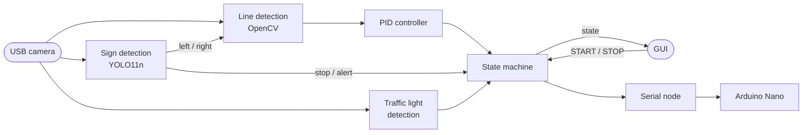

# Autonomous Line-Following Robot

An autonomous line-following robot that reads traffic signs, built with ROS 2 on a
Raspberry Pi 4.

## Overview

The robot follows a black tape line using only a USB camera. Along the track it reads
traffic signs, and it waits for a green light before it starts. All the vision and
control run on a Raspberry Pi 4, with ROS 2 Jazzy inside a Docker container, and an
Arduino Nano drives the motors.

## Features

- **Line following:** OpenCV finds the tape in every camera frame, and a PID controller
  steers the robot toward it.
- **Sign recognition:** a custom-trained YOLO11n model, exported to NCNN so it runs on
  the Pi's CPU, reads four signs. Left and right arrows choose the branch at a fork, and
  stop and alert signs make the robot stop for 3 seconds.
- **Traffic-light start:** after START is pressed, the robot waits until the light turns
  green.
- **Line recovery:** if the line slips out of view for a moment, the robot keeps its last
  turn to find it again. If the line ends right after a stop sign, the robot takes it as
  the end of the track and stays stopped.
- **GUI:** START and STOP buttons, plus the robot's live state, the last sign it
  saw and the traffic-light color, over Wi-Fi.

## How it works

Each block is its own ROS 2 node. The camera feeds three detectors: OpenCV finds the
line, YOLO reads the signs, and a color-and-shape check spots the traffic light. The PID
turns the line's offset from the center into a steering command, and the state machine
decides whether that command reaches the wheels. The serial node then converts it into
a speed for each side and sends it to the Arduino, which drives the motors through an
L298N.

## Tech stack

| Technology | What it's used for |
|---|---|
| ROS 2 Jazzy (Python) | The nodes and the messages between them |
| Docker | Running ROS 2 on the Pi in a container, with access to the camera and the Arduino |
| OpenCV | Camera capture, line detection and the traffic-light check |
| YOLO11n (Ultralytics) + NCNN | Sign recognition, running on the Pi's CPU |
| rosbridge + roslibpy | Connecting the GUI to ROS over Wi-Fi |
| Tkinter | The GUI |
| Arduino (C++) | Motor control through the L298N |

**Hardware:** Raspberry Pi 4, UGREEN 2K USB camera, Arduino Nano, L298N motor driver and
a 4WD skid-steer chassis.

## Limitations

- **Shared CPU:** YOLO and the line follower run on the same Raspberry Pi CPU, so YOLO
  only looks for signs a few times per second.
- **Motor torque:** the small DC motors have little torque, so the robot needs a short
  kick to start moving and can't turn in place.
- **Batteries:** as they drain, the motors lose power and the robot's behavior changes.
- **Camera:** if the camera disconnects, the nodes have to be restarted.
